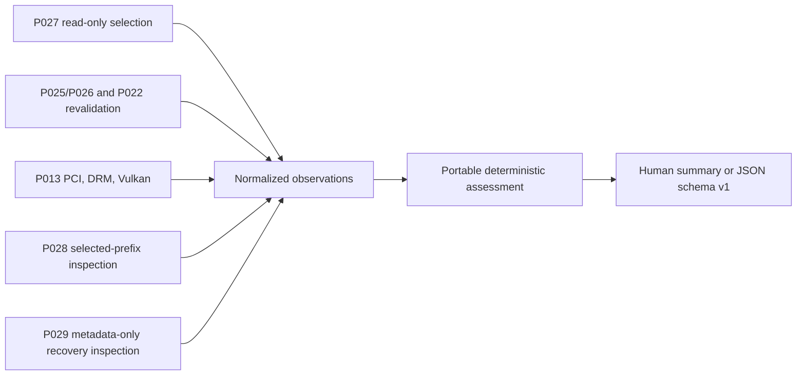

# Compatibility diagnostics (P030)

P030 adds a headless, read-only assessment of the explicitly selected Wine/Proton runtime, Linux GPU and driver observations, Vulkan capabilities, and an optional registered Endfield-Unix prefix. It combines P013, P022–P027, P028, and P029 evidence without replacing those providers or registries.

Static diagnostics describe observed structure and uncertainty. They do not establish successful Wine initialization, Direct3D translation, Endfield launch, rendering, or performance. `game_compatibility` is always `not_tested`.

## CLI

```text
endfield-unix diagnose compatibility [--profile PROFILE_ID] [--prefix-id PREFIX_ID] [--json]
```

Examples:

```bash
endfield-unix diagnose compatibility
endfield-unix diagnose compatibility --profile desktop
endfield-unix diagnose compatibility --prefix-id endfield-main --json
```

The optional profile selects the P027 profile pin using normal P027 precedence. The optional prefix ID selects exactly one registered managed prefix. The command never searches or adopts external prefixes. `--json` prints schema version 1; without it, a bounded human summary is printed. A successful partial report exits 0. Invalid identifiers or CLI syntax exit 2, output failure exits 74, and serialization/output-limit failure exits 70. Reports are generated on demand and are not persisted.

The command is dispatched by the existing `endfield-unix` executable. It does not initialize GTK, contact the daemon, spawn a process, use the network, or create XDG storage. Missing optional registries and providers produce explicit unknown or partial observations rather than fabricated installed runtimes or devices.

## Evidence flow



The `endfield-unix-compatibility-diagnostics` crate is portable and depends only on serde. It has no filesystem, process, GTK, Vulkan, or Linux discovery code. The application adapter acquires evidence through existing providers, maps it into typed states, and passes it to the core. Findings are sorted by stable ID and capped. Repeated assessment of the same observations produces the same findings; the observation timestamp is supplied by the caller.

## Runner and adapter interpretation

P027 `PinStore::load_read_only` and `resolve` determine the exact selected machine/profile pin. A stale profile pin remains selected as stale and blocks machine-pin fallback. No runtime other than the selected reference is substituted. Managed references are revalidated by the existing P025 identity and P026 complete baseline audit. External references use P022 structural identity revalidation; this is not a full integrity or authenticity assessment. The report identifies managed installation IDs and hashes or the external structural digest, never an external runtime path.

The report records family, origin, build when known, ownership, provenance, pin scope and identity, and the validation state. It does not run `wine --version`, Wine, Proton scripts, Steam, UMU, or the game. UMU structure is inspected only when a selected Proton pin records the UMU-Proton adapter. A missing UMU adapter does not switch to direct Proton. The existing P028 Wine initialization adapter remains unsupported.

## GPU and driver interpretation

P013 supplies PCI BDF, vendor/device IDs, kernel-driver binding, DRM primary/render nodes and access observations. Intel, NVIDIA, AMD, and unknown PCI vendors are represented without a hardcoded support list. GPU class and Vulkan-to-PCI correlation are retained only when the provider has evidence. Multiple devices and ambiguous, conflicting, or unmatched correlations remain explicit; unmatched DRM nodes are retained separately; enumeration order never selects a GPU.

Kernel module binding, DRM access, Vulkan driver identity, and driver-provided `driver_info` are separate fields. P030 does not infer an NVIDIA version from the kernel release or assume the kernel module and userspace stack match. Kernel driver version stays absent when no source reports it. DRM access checks do not open device nodes. A future game process's selected GPU remains unknown.

## Vulkan interpretation

P030 extends the existing ash-based P013 observation. It reports loader status, instance/enumeration outcome, per-device Vulkan API version and type, driver properties when supplied, bounded extension names and queried Vulkan 1.0 feature flags. PCI identity is reported only from validated `VK_EXT_pci_bus_info` evidence. Device-local heaps are not translated into a performance or dedicated-VRAM claim.

Vulkan availability and advertised static capabilities do not establish DXVK or VKD3D-Proton presence, Direct3D 11/12 support, or Endfield compatibility. The JSON `translation_layer_readiness` field stays `unknown_or_unverifiable` because authoritative, versioned requirements or selected-runner component metadata are not available. P030 does not download, execute, or inspect compatibility-layer binaries.

## Prefix and recovery interpretation

Only the explicit registered prefix ID is passed to P028 `PrefixStore::show`. The report retains machine/profile scope, lifecycle, owner validation, filesystem validation, saved runtime association, original pin ID/revision and adapter, current P027 relation, and initialization evidence availability.

`Created` means the managed directory exists. It does not mean Wine initialized it. P028's `initialization_unsupported` behavior is unchanged, and P030 does not synthesize `Initialized` state or evidence. A stale runtime association, missing directory, blocked ownership, or unknown initialization evidence remains explicit.

P029 restore/rollback state, snapshot deletion intents, and P027 pin-recovery markers are read through a metadata-only observer. It reads bounded transaction metadata and directory identities; it does not hash, traverse, or read prefix or snapshot payload contents. Pending deletion, pending pin recovery, or inconsistent markers prevent positive readiness findings. P030 does not repair, replay, release, roll back, or mutate any journal.

## Findings and verdicts

Each finding includes a stable ID, component, state, severity, confidence, evidence source and strength, observed value where safe, expected condition when grounded, reason, evidence limitations, a conservative suggested action, and whether the action is supported by Endfield-Unix. The verdict summarizes only checked static observations; it is not a launch-readiness or game-compatibility score.

- A valid selected runtime plus missing Vulkan reports those observations independently and performs no fallback.
- Vulkan devices plus a stale selected runtime leave runtime readiness blocked; Vulkan does not repair runtime identity.
- A Created prefix reports initialization as unverified.
- Multi-GPU systems preserve unmatched or ambiguous identities and do not automatically select a GPU.
- “No known static blocker” is emitted only when selected runtime identity/integrity, adapter, GPU/DRM/Vulkan observations, and a matching initialized prefix are all observed. Even then, actual Endfield compatibility remains `not_tested`.

## Privacy and bounds

P030 does not print raw `/etc/machine-id`, absolute runtime/prefix paths, home directories, credentials, game saves, prefix payloads, or arbitrary filesystem contents. User-selected profile and prefix IDs are included as request identifiers. External runtime identity is represented by P022's non-authenticating structural digest. Platform and device strings, device/extension counts, findings, and output bytes are bounded. JSON output is capped at 1 MiB; human output is capped at 64 KiB and 48 findings.

The versioned generated report contract is [compatibility-diagnostics-v1.schema.json](schema/compatibility-diagnostics-v1.schema.json). The current CLI prints reports on demand and does not persist them.

## Optional physical-device procedure

These checks do not modify runtime selection, graphics settings, drivers, or prefixes. Use only the machine's existing P027 pin and an already registered prefix; do not create or initialize one for this procedure.

**Desktop with RTX 5070:** run `endfield-unix diagnose gpu`, then `endfield-unix diagnose compatibility --profile desktop --json` if that profile is already configured. Record the PCI BDF and vendor/device IDs, observed NVIDIA kernel binding, DRM node relationship and access, Vulkan BDF/type/API version, driver ID/name/info, and selected runner identity/build. GE-Proton 10-26 is a target observation only when P022/P027 reports it.

**Dell Vostro 3510 with Iris Xe and MX350:** run the same commands with the existing profile ID if present. Record the Intel and NVIDIA BDFs, observed `i915`/NVIDIA binding when present, each DRM relationship, and each Vulkan identity. Preserve unmatched or ambiguous correlations; the report does not select an adapter or establish which GPU a future process uses.

Keep synthetic fixtures, hosted checks, and physical-device observations in separate evidence records. Neither procedure launches Wine/Proton, UMU, a game, a benchmark, or a Vulkan workload. Do not interpret enumeration as successful Endfield rendering or performance evidence.

## Qualification status

Synthetic core and provider tests exercise empty/partial hosts, stale runtime versus Vulkan, driver binding and permissions, hybrid-device ambiguity, metadata preservation, Created prefixes, incomplete recovery, deterministic findings, and bounded arrays. Actual-binary isolated-XDG tests cover JSON and human output, exit codes/help, no XDG creation, profile precedence with a stale blocking pin, missing prefixes, and Created-prefix reporting. Hosted final-head and native GTK qualification are tracked in the [P030 manifest](manifests/PROMPT030_MANIFEST.md). The RTX 5070 and Dell Vostro 3510 procedures are optional physical checks; neither system nor actual Endfield rendering is claimed as tested.
